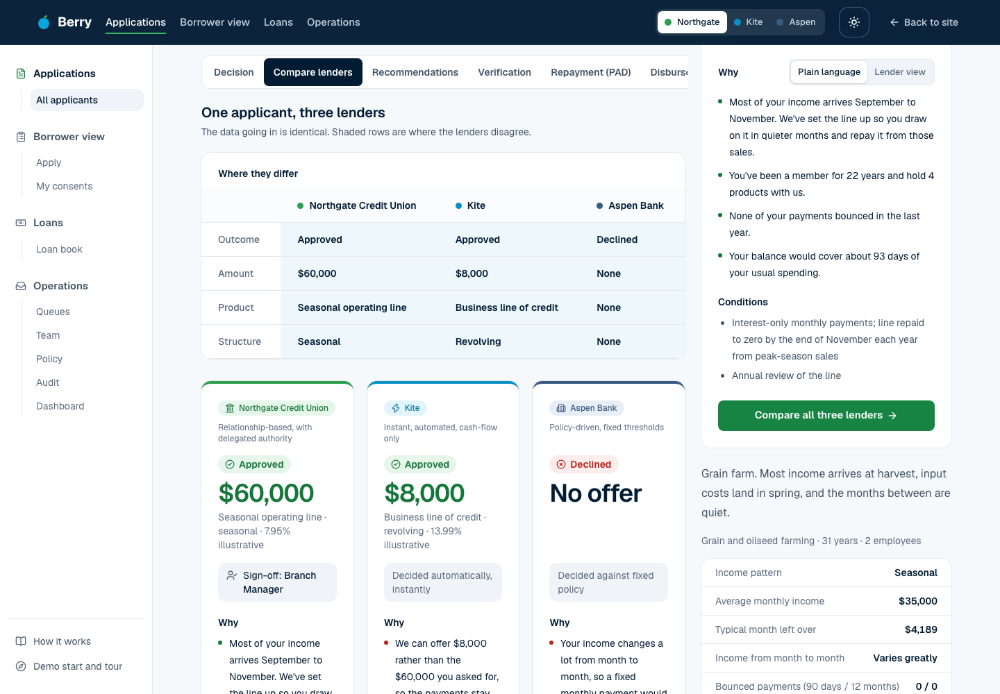
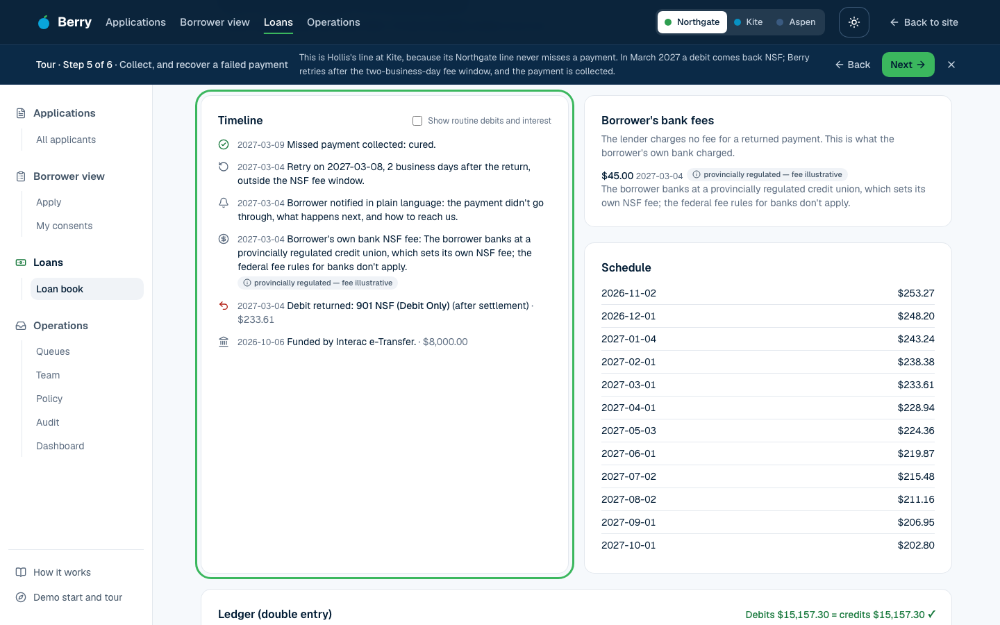
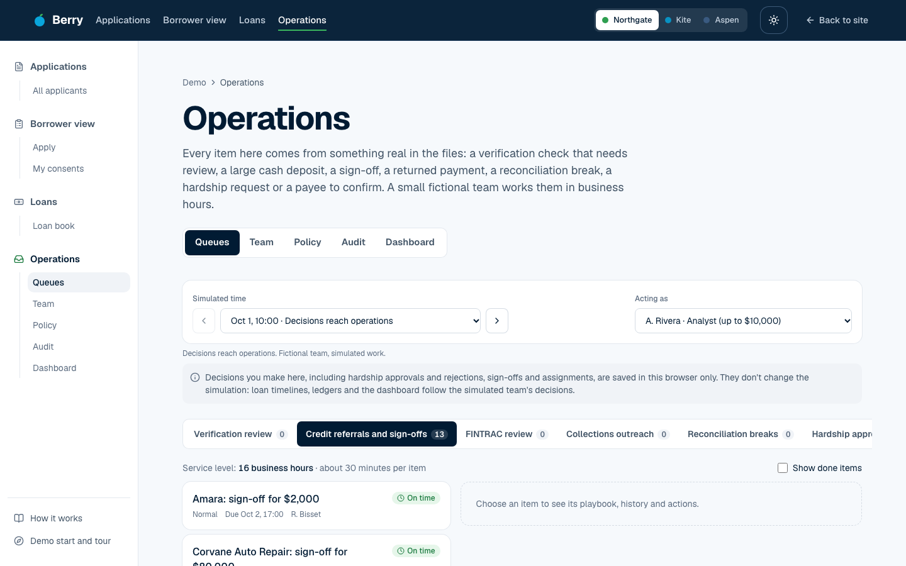
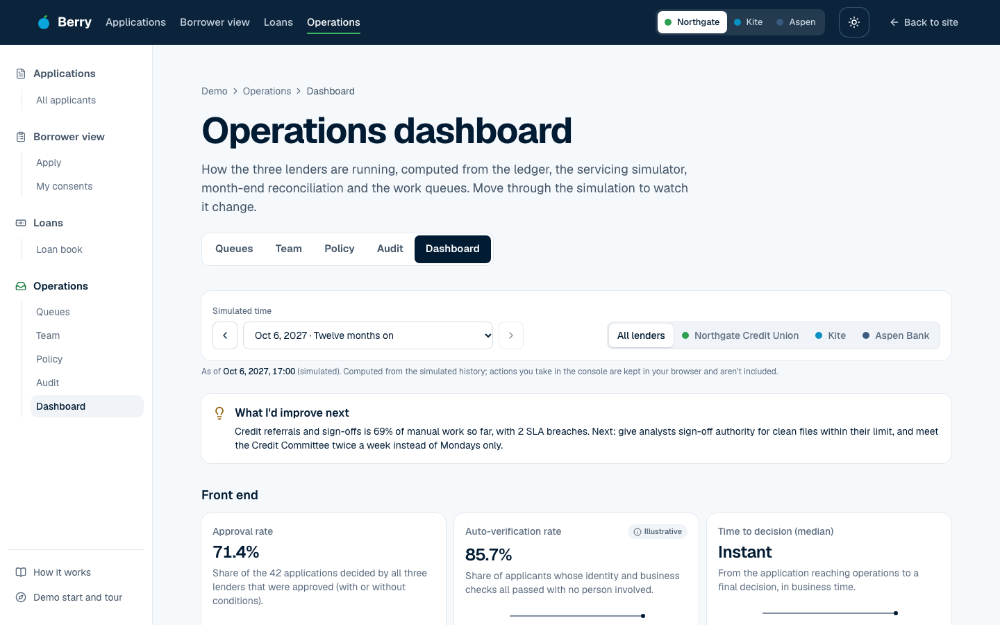
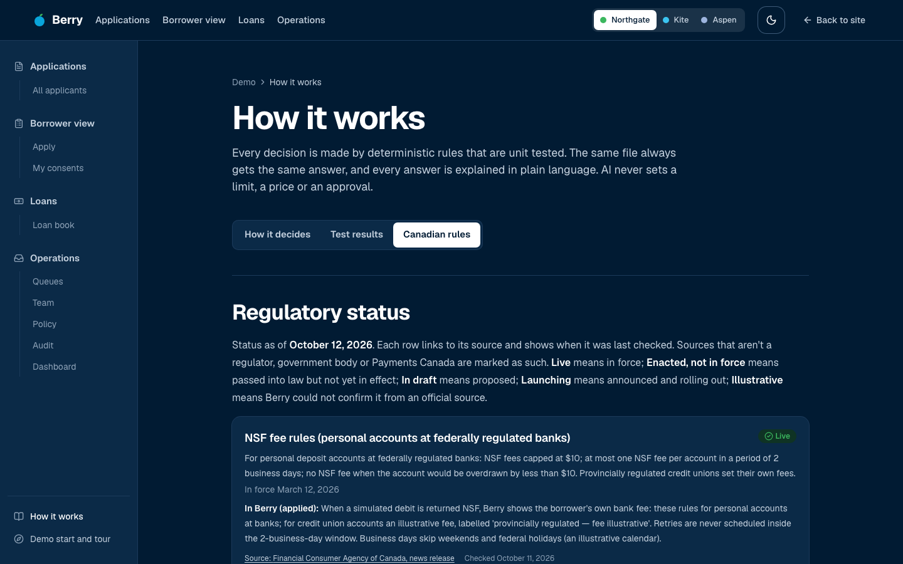
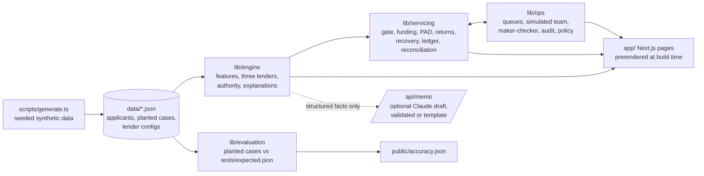

# Berry

**One applicant. Three lenders. Three different answers.**

Berry is a portfolio project designed and directed by Joshua Osunbor and built with Claude Code as the coding agent. It shows how a credit union, a bank and a fintech read the same cash flow differently, explains every decision in plain language, and then follows the loan through funding, pre-authorized debit collections, failed-payment recovery and reconciliation, all run from an operations console.

**Live demo: [berry-lending.fly.dev](https://berry-lending.fly.dev)** — no sign-up. Start at [/demo](https://berry-lending.fly.dev/demo) for a three-minute guided tour.

> **Fictional institutions. Synthetic data.** Northgate Credit Union, Kite and Aspen Bank are invented, every applicant and transaction is generated, and nothing connects to a real bank, bureau or identity service. A portfolio project by [Joshua Osunbor](https://www.linkedin.com/in/joshua-osunbor-06b26bb5/).



---

## What it shows

A grain farm, Hollis Family Farm, earns most of its year's income at harvest. Given the same twelve months of bank data:

| Lender | Style | Answer |
|---|---|---|
| **Aspen Bank** | Policy-driven: fixed thresholds | Declines: income varies too much month to month |
| **Kite** | Automated: cash flow only | Approves an $8,000 line of credit, sized on the median month |
| **Northgate Credit Union** | Relationship: delegated authority | Approves a $60,000 seasonal operating line, repaid after harvest, signed off by the Branch Manager |

None of them is wrong. They read the same cash flow differently, and Berry shows exactly why: every reason is written twice, once for the borrower and once for the lending team, with what would change the answer.

## Try it

| Section | What you'll see |
|---|---|
| [Applications](https://berry-lending.fly.dev/applications) | Fourteen synthetic applicants (salaried, gig, newcomer, seasonal, small business), each decided by all three lenders. Each file has the cash flow, the decision and its reasons, identity checks, the PAD schedule, a sample AFT file, servicing, a credit memo, the inputs used, and a **Compare lenders** tab. |
| [Borrower view](https://berry-lending.fly.dev/borrower/apply) | Apply as a borrower would: consent to share data, identity checks, your request, and the answer. Consents can be revoked in one click. |
| [Loans](https://berry-lending.fly.dev/loans) | Every approved loan after funding: its double-entry ledger, collections, returned payments and recovery, with a clock to fast-forward a year. |
| [Operations](https://berry-lending.fly.dev/operations) | Work queues with service levels, maker-checker approvals within delegated authority, versioned policy changes with an impact preview, an append-only audit trail, and the [dashboard](https://berry-lending.fly.dev/operations/dashboard). |
| [How it works](https://berry-lending.fly.dev/how-it-works) | How each lender decides, the published test results, and the Canadian rules Berry follows with their current status and sources. |

| | |
|---|---|
|  |  |
|  |  |

## How decisions work

- **Deterministic and tested.** Limits, prices and approvals come from rules in `lib/engine`, unit tested. The same file always gets the same answer. AI never sets a limit, a price or an approval.
- **Cash flow, read the same way for everyone.** Twelve months of transactions in an FDX-inspired format become features: income and its variability, the median month, days of cash on hand, returned payments, existing debt and debt service coverage, and the income pattern (salaried, gig, seasonal, invoice-based…).
- **Three thin rulebooks over the same features.** Each lender's limits, rates, thresholds and authority tiers live in `data/institutions/*.json`, are versioned, and can be changed through the policy console with a before-and-after impact preview.
- **Blind to who you are.** Name, age, gender, nationality, immigration status and postal code never reach the engine. A test shuffles them across every applicant and checks that no decision changes. A foreign credit report can track nationality, so Berry uses only its rating, never the country, and says so.
- **Published accuracy.** 37 planted cases with expected outcomes written from the case design and each lender's stated policy: [111 of 111 decisions match](https://berry-lending.fly.dev/how-it-works?tab=test-results). That shows the rules are applied as written, not that they're good lending: the expectations and the engine share an author.
- **AI drafts the memo; the engine and a human decide.** An optional Claude-drafted credit memo receives only structured engine output (no transactions, no personal data), and every figure in the draft is checked against the engine before it's shown; otherwise a template memo is used.

## Money movement and operations

- **Funding** waits for a pre-funding gate (sign-off, identity checks, documents, conditions), then pays out by a sample AFT file, or simulated Interac e-Transfer or Real-Time Rail.
- **Collections** follow Payments Canada Rule H1: one payment per debit at its own amount, with pre-notification before any change.
- **Returns** use Standard 007 reason codes. An NSF return is retried once, outside the two-business-day window in which the borrower's bank could charge another NSF fee.
- **Hardship** deferrals take effect only after a second person approves them, and move the schedule rather than collecting a lump sum.
- **Reconciliation** matches the ledger against a bank statement built independently from what the bank saw, month by month.
- **The ledger** is double-entry in whole cents, append-only, and balanced after every posting; charge-offs reverse unpaid interest.
- **The operations console** runs a simulated team in business hours, so service levels are met or breached by real backlog. Maker-checker reads who prepared each request from the hash-chained audit trail.

## Architecture



Next.js (App Router, TypeScript), Tailwind CSS, Recharts, Zod, Vitest and Playwright. There's no database: the synthetic data is versioned JSON, and every decision, schedule, ledger and queue is computed at build time, so pages prerender as static HTML. Servicing and operations feed each other (a deferral starts when its approval completes; funding waits for sign-off), so `lib/data.ts` simulates, has the team work the queues, and simulates again until nothing moves.

## Run it

```bash
npm install
npm run dev          # http://localhost:3000
npm test             # unit tests (Vitest)
npm run test:e2e     # production build + Playwright, desktop and phone, with axe accessibility checks
npm run accuracy     # planted-case evaluation; writes public/accuracy.json
npm run generate     # regenerate the seeded synthetic data
npm run typecheck && npm run lint
```

Set `ANTHROPIC_API_KEY` to have Claude draft credit memos; without it, Berry uses its template memo. CI runs lint, typecheck, unit tests, the accuracy check and the e2e suite on every push.

## Canadian rules and sources

Berry builds around these rules and systems; [How it works → Canadian rules](https://berry-lending.fly.dev/how-it-works?tab=canadian-rules) shows each one's status with its source and the date it was last checked (status as of October 12, 2026).

| Rule or system | Status | Source |
|---|---|---|
| NSF fee rules (personal accounts at federally regulated banks) | Live | [FCAC news release](https://www.canada.ca/en/financial-consumer-agency/news/2026/03/new-nsf-fee-regulations-bring-down-cost-of-banking-for-canadians.html) |
| Rule H1: pre-authorized debits | Live | [Payments Canada, Rule H1](https://www.payments.ca/sites/default/files/h1eng.pdf) |
| Standard 005: AFT file format | Live | [Payments Canada, Standard 005](https://www.payments.ca/sites/default/files/standard005eng.pdf) |
| Standard 007: return reason codes | Live | [Payments Canada, Standard 007](https://www.payments.ca/sites/default/files/standard007eng.pdf) |
| FINTRAC Large Cash Transaction Reports | Live | [FINTRAC guidance](https://fintrac-canafe.canada.ca/guidance-directives/transaction-operation/lctr-doie/lctr-doie-eng) |
| CDIC deposit insurance | Live | [CDIC, what's covered](https://www.cdic.ca/your-coverage/whats-covered/) |
| Provincial credit union deposit insurance | Live | [CDIC glossary](https://www.cdic.ca/glossary/) and each provincial insurer |
| Consumer-Driven Banking Act | Enacted, not in force | [Justice Laws](https://laws-lois.justice.gc.ca/eng/acts/C-36.78/page-1.html) |
| Consumer-Driven Banking Regulations | In draft | [Canada Gazette, Part I, June 27, 2026](https://gazette.gc.ca/rp-pr/p1/2026/2026-06-27/html/reg3-eng.html) |
| Real-Time Rail | Launching (initial launch Q4 2026) | [Payments Canada](https://www.payments.ca/real-time-rail-payment-system) |
| Foreign credit reports for newcomers | Live, with limited country coverage | [Equifax Canada](https://www.equifax.ca/about-equifax/newsroom/-/intlpress/equifax-canada-champions-financial-inclusion-for-newcomers-to-canada-with-the-launch-of-global-consumer-credit-file/) (company source) |

Transactions are **FDX-inspired**. Berry doesn't claim FDX is Canada's standard: the draft regulations leave the technical standards body to be designated by the Minister.

## Status and limitations

- **Synthetic and fictional throughout.** No real people, banks, bureaus, registries or identity services. Postal codes start with Z, which Canada Post never uses.
- **Simulated, not live:** consumer-driven banking consent (built around the draft framework's consent principles; Berry isn't accredited), identity and business checks, Interac e-Transfer and Real-Time Rail funding, and all servicing.
- **Illustrative:**
  - every rate, limit, threshold, authority tier and fee
  - the AFT file (ASCII rather than EBCDIC; not for submission)
  - retry policy by return reason and the notice given for a retry
  - the holiday calendar (federal holidays; Payments Canada's own 2026–2027 calendar couldn't be read)
  - provincial deposit insurance limits for BC, Ontario and Quebec
  - the Real-Time Rail's post-launch phases (press-reported only)
- **The accuracy score** shows the engine applies its stated policies. It says nothing about real credit performance, and limits aren't scored, only outcomes and approvers.
- **Decisions made in the browser stay in the browser.** In the operations console, approvals, rejections and assignments are saved locally and don't change the simulation, which follows the simulated team.
- **In production** this would need consented data under an accredited framework, bureau data alongside cash flow, model monitoring, adverse-action notices reviewed by compliance, and human review of referrals and exceptions.

## Licence

All rights reserved; published to be read, run locally and evaluated. See [LICENSE](LICENSE).
